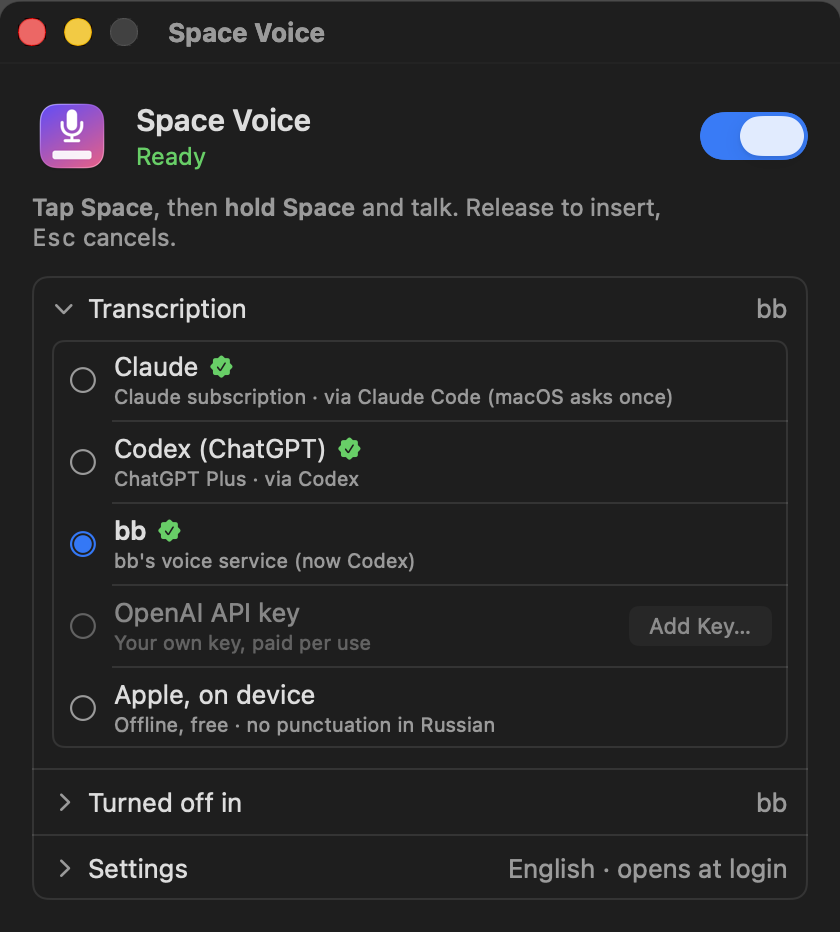
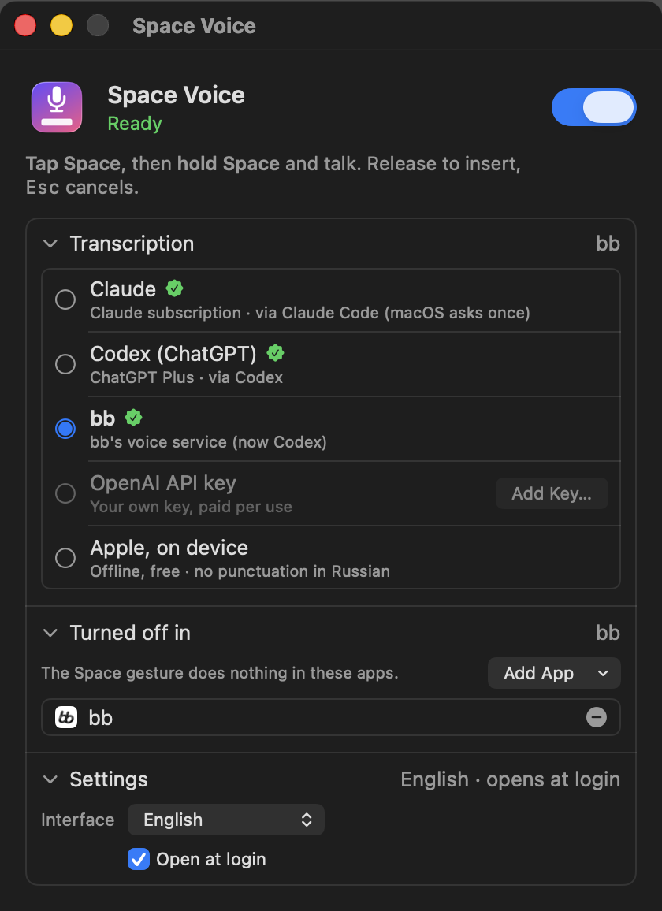

# Space Voice

**Dictate into any text field on your Mac: tap Space, then hold Space and talk.**

Space Voice is a small menu bar app for macOS. It brings the "tap Space, then hold Space" dictation
gesture from [bb](https://getbb.app) to every app: browsers, chats, editors, terminals.
Release Space and what you said is typed where your cursor is.

It transcribes with services you already have: your **Claude** or **ChatGPT (Codex)** subscription,
**bb**, your own **OpenAI API key**, or **Apple's on-device model**, which works offline.

<p align="center">
  
</p>

<p align="center">
  
  &nbsp;
  
</p>

## How it works

1. Put the cursor in any text field.
2. **Tap Space**, then **press and hold Space**. A pill at the bottom of the screen shows the app is listening.
3. Talk. With Claude or Apple, the words appear in the pill as you speak.
4. **Release Space.** The text is inserted at the cursor.

Typing doesn't change:

- A quick double tap still types two spaces. Only a *held* second press starts dictation.
- `Esc` while holding Space cancels the recording.
- The space from the first tap is removed, unless it separates your dictation from the word before it.
- Text is inserted by pasting. Your clipboard is put back right after.
- Password fields are never affected: macOS hides their keystrokes from other apps.

## Install

Requires **macOS 14 Sonoma** or later. Apple's on-device engine needs **macOS 26**.

### Homebrew

```bash
brew install --cask grishaster80/tap/space-voice
```

### Download

Get `SpaceVoice-<version>.zip` from [Releases](../../releases), unzip it and move **SpaceVoice.app** to
`/Applications`. The app isn't notarized yet, so the first time, right-click it and choose **Open**,
or run:

```bash
xattr -dr com.apple.quarantine /Applications/SpaceVoice.app
```

### Build from source

```bash
git clone https://github.com/grishaster80/space-voice.git
cd space-voice
scripts/build-app.sh                       # builds build/SpaceVoice.app (Apple silicon + Intel)
cp -R build/SpaceVoice.app /Applications/
open /Applications/SpaceVoice.app
```

You need Xcode 26 or later (the macOS 26 SDK, for Apple's on-device engine). The script signs the app with your first *Apple Development*
certificate, or ad hoc if you have none. Pick another one with `SIGN_IDENTITY="…" scripts/build-app.sh`.

## First launch

The Space Voice window opens and asks for two permissions:

| Permission | Why |
| --- | --- |
| **Accessibility** | To notice the Space gesture in every app and to paste the text. |
| **Microphone** | To hear you. The microphone is on only while you hold Space. |

macOS ties these permissions to the app's signature, so always build with the same certificate.
Otherwise macOS asks again after an update.

After that, Space Voice lives in the menu bar (the microphone icon). If the notch hides the icon,
open the app again, from Spotlight or `/Applications`, to bring the window back.

## Transcription engines

The **Transcription** section lists what was found on this Mac. Pick one with a click.
If you don't pick, Space Voice uses the first available of Codex, bb, OpenAI and Apple.

| Engine | What it uses | Notes |
| --- | --- | --- |
| **Claude** | Your Claude subscription, through the claude.ai sign-in of [Claude Code](https://claude.com/claude-code) | Streams, so words appear while you talk. Set the language you speak in the app. macOS asks once to let Space Voice read Claude Code's keychain item. |
| **Codex (ChatGPT)** | Your ChatGPT plan, through the sign-in of the [Codex CLI](https://github.com/openai/codex) (`~/.codex/auth.json`) | Fast (about 1 s), detects the language, handles mixed languages and technical terms well. |
| **bb** | `bb voice transcribe`: the voice service chosen in bb | Shows which service bb uses now (Codex or bb cloud). |
| **OpenAI API key** | Your own key, `gpt-4o-transcribe` | Paid per use. The key is kept in your login keychain. |
| **Apple, on device** | Apple's dictation model (`SpeechAnalyzer`, macOS 26) | Offline and free. Downloads the language model on first use. No punctuation in Russian. |

If an online engine fails, for example because of a network error, Space Voice transcribes the same
recording with Apple's on-device model, so your words aren't lost.

> **Note on Claude and Codex.** These engines call the services Claude Code's voice mode and Codex
> use, with the sign-ins those apps already keep on your Mac. They aren't public APIs, so they can
> change without notice. Space Voice reads the sign-ins locally, sends them only to Anthropic or
> OpenAI, and never stores or copies them. When a sign-in expires, open Claude Code or Codex once
> to renew it.

## Privacy

- Audio is recorded only while you hold Space, and goes only to the engine you chose. With
  Apple's engine it never leaves your Mac.
- No analytics, telemetry or servers of its own.
- No keys are built into the app. Your OpenAI key, if you add one, is stored in your login keychain.
- If a transcription fails completely, the last recording is kept at
  `~/Library/Caches/io.github.grishaster80.spacevoice/last-failed.wav` so you can retry it. It is
  overwritten by the next failure.

## Settings

- **Enabled:** the switch in the window, or the menu bar icon.
- **Turned off in:** apps where the gesture does nothing. bb is in the list by default because it
  has its own Space Voice plugin. Add apps from the window, or with **Turn Off in "<app>"** in the
  menu bar icon.
- **Interface:** English or Russian (by default, the macOS language).
- **Open at login.**
- **Sounds:** a click when recording starts and stops (menu bar icon).

## Development

```
Sources/SpaceVoice/
  SpaceGesture.swift        global event tap: the tap-then-hold-Space gesture
  DictationController.swift one dictation: microphone → engine → insertion, with on-device fallback
  Recorder.swift            microphone capture as 16 kHz mono
  Transcribers.swift        engines: bb, OpenAI, Apple, Codex, Claude
  Accounts.swift            reads the Claude Code and Codex sign-ins
  Engines.swift             which engines this Mac has, and the default order
  TextInserter.swift        paste at the cursor, restore the clipboard
  HUD.swift                 the pill at the bottom of the screen
  MainWindow.swift          the app window
  AppDelegate.swift         menu bar icon and menu
scripts/
  build-app.sh              build, bundle and sign SpaceVoice.app
  make-icon.swift           draws the app icon
  release.sh                publish a release and update the Homebrew cask
packaging/space-voice.rb    Homebrew cask template
```

Flags for development:

```bash
swift build
.build/debug/SpaceVoice --transcribe speech.wav --engine codex      # claude | codex | bb | openAI | apple
open -n -W build/SpaceVoice.app --args --snapshot window.png [expanded]  # render the window
build/SpaceVoice.app/Contents/MacOS/SpaceVoice --snapshot-hud pill.png "Some text"
```

### Releasing

```bash
scripts/release.sh 0.2.0
```

This builds and signs the app, uploads `SpaceVoice-0.2.0.zip` to this repository's Releases, and
updates `Casks/space-voice.rb` in [grishaster80/homebrew-tap](https://github.com/grishaster80/homebrew-tap).
